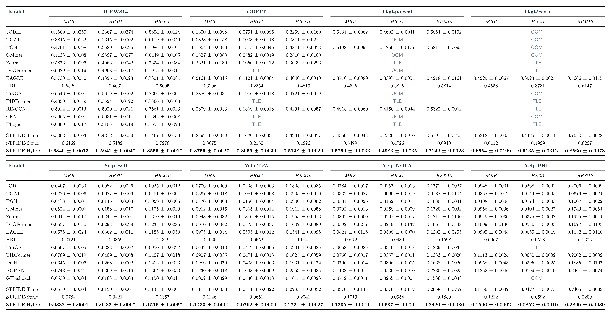

# STRIDE

The complete results with standard deviations over three runs are shown below. Each cell reports mean ± std.



<sub>Note: STRIDE-Structure and HRI (History Repeat Itself) are deterministic methods with no random choices, so their standard deviations are zero (std = 0).</sub>

Below is the code of our submission. Thanks for your reviewing!

## 📚 Guide

### 📦 Requirements

Required packages and versions:

- `matplotlib==3.8.4`
- `networkx==3.3`
- `numba==0.60.0`
- `numpy==1.26.4`
- `ogb==1.3.6`
- `pandas==1.5.3`
- `pyg-lib==0.4.0+pt20cu118`
- `scikit-learn==1.5.2`
- `scipy==1.13.1`
- `torch==2.0.1+cu118`
- `torch_geometric==2.5.3`
- `lightgbm==4.6.0`
- `psutil==6.0.0`
- `tqdm==4.66.4`
- `py-tgb==2.0.0`

We can install the required dependencies with:

```bash
pip install -r requirements.txt
```

### 📊 Datasets

Download the datasets and spatial information from [Google Drive](https://drive.google.com/drive/folders/1pV3sKQyK-N5wvinwo6l7DuM26-hPBTPO?usp=drive_link). Place the dataset folders as described in [STRG_LP/data/README.md](STRG_LP/data/README.md) and [Homogeneous_Graph_LP/data/README.md](Homogeneous_Graph_LP/data/README.md).

The graph data for tkgl-polecat and tkgl-icews will be downloaded automatically from official TGB2 benchmark on the first run.

### ▶️ Run

The following commands reproduce the results with the best hyperparameters. Run each command block from the repository root.

```bash
cd STRG_LP
python train_hybrid.py --dataset ICEWS14 --use_best_hyper_params --gpu 0
python train_hybrid.py --dataset GDELT --use_best_hyper_params --gpu 0
python train_hybrid.py --dataset tkgl-polecat --use_best_hyper_params --gpu 0
python train_hybrid.py --dataset tkgl-icews --use_best_hyper_params --gpu 0
python train_hybrid.py --dataset Yelp-BOI --use_best_hyper_params --gpu 0
python train_hybrid.py --dataset Yelp-TPA --use_best_hyper_params --gpu 0
python train_hybrid.py --dataset Yelp-NOLA --use_best_hyper_params --gpu 0
python train_hybrid.py --dataset Yelp-PHL --use_best_hyper_params --gpu 0
```

```bash
cd Homogeneous_Graph_LP
python train_hybrid.py --dataset wikipedia --use_best_hyper_params --gpu 0
python train_hybrid.py --dataset Contacts --use_best_hyper_params --gpu 0
python train_hybrid.py --dataset lastfm --use_best_hyper_params --gpu 0
python train_hybrid.py --dataset reddit --use_best_hyper_params --gpu 0
python train_hybrid.py --dataset askubuntu --use_best_hyper_params --gpu 0
python train_hybrid.py --dataset superuser --use_best_hyper_params --gpu 0
python train_hybrid.py --dataset wikitalk --use_best_hyper_params --gpu 0
```

To run the time-aware module or structure-aware module separately with their standalone best hyperparameters:

```bash
cd STRG_LP
python train_time.py --dataset ICEWS14 --use_best_hyper_params --gpu 0
python train_structure.py --dataset ICEWS14 --use_best_hyper_params --gpu 0
```

```bash
cd Homogeneous_Graph_LP
python train_time.py --dataset wikipedia --use_best_hyper_params --gpu 0
python train_structure.py --dataset wikipedia --use_best_hyper_params --gpu 0
```

Note: The standalone best hyperparameters for the time-aware and structure-aware modules may differ from those used by the best hybrid model.
All configurations and best hyperparameters are listed in `STRG_LP/configs/best-hyper-params/` and `Homogeneous_Graph_LP/configs/best-hyper-params/`.

## 📬 Contact

Thank you for reviewing our code. If you have any questions or suggestions, please feel free to leave a comment via the review system or open an issue.
